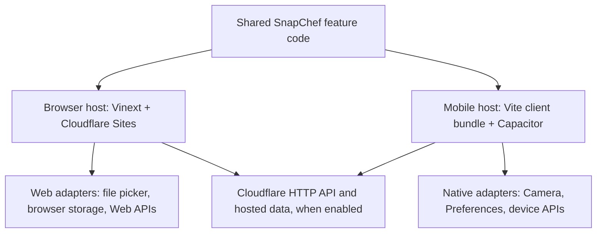

# SnapChef mobile portability plan

Status: Step 2 architecture approved and documented on 2026-08-25.

Update 2026-09-12: The user subsequently authorized autonomous local implementation, with image integration excluded. The historical confirmation gates below no longer require approval for each local coding step. See [local development](local-development.md) for implemented capabilities and remaining work. Vercel and Supabase are under consideration; the historical Cloudflare backend choice below is not a newly confirmed final hosting decision. No backend migration or public deployment has been performed.

Implementation note: Steps 3–5 are complete through the generated Android project and web-asset synchronization. The static build is installable/offline-capable where the browser accepts SVG manifest icons. Final APK compilation is waiting on an Android SDK installation. Native camera/Preferences plugins remain unimplemented. Image recognition is implemented through a hosted endpoint and requires the configuration described in `docs/image-recognition.md`.

## Objective

Keep SnapChef fully usable in modern web browsers while adding installable Android and iOS applications from the same product code. Android is the first native target. iOS follows after the shared mobile foundation is proven.

## Confirmed decisions

- Keep the Vinext and Cloudflare Sites application as the browser experience and hosted backend.
- Use Capacitor for the native Android and iOS containers.
- Build Android first on Windows with Android Studio.
- Produce a bundled mobile web build for the native container. Do not make the production app a thin wrapper around a remote website.
- Share product logic, React UI, data types, and platform contracts across browser and native builds.
- Put browser and native behavior behind small platform adapters with equivalent fallbacks.
- Require explicit user confirmation before every implementation or configuration step.

Capacitor is designed to be added to existing modern web projects and provides web-focused APIs plus access to native device capabilities: <https://capacitorjs.com/docs>.

## Current baseline

SnapChef is a Vinext React application hosted through Cloudflare Sites. The primary screen is client-side React, while metadata and hosting are server-rendered. Recipe data and matching are local TypeScript modules. Image analysis uses an optional server-side OpenAI endpoint; manual matching continues to work without it. D1 and R2 are not enabled.

Current strengths:

- Responsive layouts already exist for tablet and phone widths.
- Recipe ranking and recipe data are portable, framework-independent TypeScript.
- Image selection uses browser-standard `File` and object URL APIs.
- The main feature currently has no mandatory backend dependency.
- Existing HTML-render tests protect the browser experience.

Current gaps:

- No PWA manifest, service worker, install flow, or offline strategy.
- No Capacitor project or native platform configuration.
- No native camera integration.
- Ingredients and saved recipes persist on the current device. Uploaded photos and temporary search filters do not persist.
- The 20 most recently viewed recipes and cooked status persist on the current device. Cooking progress and filter choices are session-only.
- Shopping-list items and their checked state persist on the current device and remain shared by the browser and Android interface.
- No safe-area layout handling for notches and system bars.
- Some controls and modal dimensions need mobile touch and viewport refinement.
- Build scripts use Unix-style environment-variable syntax and are not portable to Windows without a workaround.
- The Vinext server build cannot be copied directly into a Capacitor `webDir` as an offline client bundle.
- ChatGPT header authentication and Cloudflare bindings are server-only and must never be imported into the native client.

## Target architecture



The browser host remains the canonical website. A small mobile entry point will render the same shared SnapChef feature component inside a Vite client build. Capacitor will package that build as native application assets.

Suggested source boundaries:

```text
app/
  page.tsx                  Browser entry point
components/snapchef/
  SnapChefApp.tsx           Shared client UI
shared/snapchef/
  recipes.ts                Shared recipe data
  recipe-matcher.ts         Shared pure business logic
  platform.ts               Platform service contracts
platform/web/
  image-source.ts           Browser file-picker fallback
  storage.ts                Browser persistence
mobile/
  src/main.tsx              Native-container entry point
  src/platform/             Capacitor implementations
  capacitor.config.ts       Native container configuration
```

The exact moves will be made incrementally so the website remains runnable after every confirmed step.

## Browser compatibility contract

The browser version is not a secondary fallback. Every shared feature must work without Capacitor installed.

| Capability | Browser behavior | Native behavior |
| --- | --- | --- |
| Add ingredients | Existing form and keyboard input | Same shared UI |
| Select photo | Standard file input | Native camera or photo library |
| Preview photo | Object URL with cleanup | Native URI normalized for display |
| Persist ingredients | Browser storage adapter | Capacitor Preferences adapter |
| Recipe matching | Shared pure TypeScript | Shared pure TypeScript |
| Image analysis | HTTP service with browser-safe upload | Same HTTP service using native-selected image |
| Share recipe | Web Share API with copy fallback | Native Share plugin |
| Offline state | Cached shell and local data | Bundled shell and local data |
| Authentication | Browser redirect/session flow | Native-safe OAuth flow to be designed before activation |

Rules:

1. Shared UI modules may not directly import Capacitor plugins.
2. Native plugins are loaded only inside native adapters and only in client code.
3. Every native capability must have a browser implementation or a graceful browser fallback.
4. Server-only modules such as Cloudflare bindings, request headers, and secrets stay outside shared and mobile bundles.
5. Browser URLs, API origins, and mobile API origins come from validated environment configuration rather than hard-coded production values.
6. No secret or private key is included in browser or mobile bundles.
7. Existing browser rendering and keyboard accessibility remain regression requirements.

## Delivery sequence and confirmation gates

### Step 1 — Audit

Completed. The current application, browser APIs, responsive behavior, hosting model, and mobile constraints were reviewed without changes.

### Step 2 — Architecture documentation

Completed by this document. No dependencies or native projects are added in this step.

### Step 3 — Cross-platform build foundation

Proposed work:

- Make development, build, and test scripts work consistently on Windows, macOS, and Linux.
- Extract the current page into a reusable SnapChef feature component without changing appearance or behavior.
- Keep the browser entry point thin and unchanged from the user's perspective.
- Establish platform service contracts with browser implementations only.
- Run the existing browser build and rendered-HTML test.

Gate: browser output must remain functionally equivalent and the repository must build before proceeding.

### Step 4 — Mobile and PWA interface hardening

Proposed work:

- Add safe-area padding and dynamic viewport units.
- Verify minimum touch-target sizes and non-hover interactions.
- Improve modal behavior on small screens and when the virtual keyboard is open.
- Add web app metadata, install icons, manifest, and a conservative offline shell.
- Add browser persistence for ingredients and user preferences.

Gate: browser build, tests, and confirmed mobile-width behavior must pass.

### Step 5 — Capacitor and Android scaffold

Proposed work:

- Add pinned Capacitor dependencies.
- Add the separate Vite mobile entry and build output.
- Initialize Capacitor configuration with the approved application ID and display name.
- Generate the Android project.
- Keep native generated files versioned according to Capacitor conventions.

Gate: mobile web bundle must build and synchronize into Android without changing the browser build.

### Step 6 — Native capability adapters

Proposed work:

- Add camera/photo-library support with the existing browser file picker retained.
- Add native persistence with the browser storage fallback retained.
- Add platform-aware sharing only if approved.
- Define permissions and user-facing permission explanations.

Gate: browser fallbacks and Android native behavior must both pass.

### Step 7 — Android build and device validation

Proposed work:

- Configure Android Studio and required SDK components after approval.
- Build a debug APK.
- Test launch, rotation, back-button behavior, camera permissions, photo selection, persistence, offline launch, and network recovery.
- Record known device-specific issues.

Gate: a repeatable Android debug build and validation checklist must pass.

### Step 8 — iOS preparation and build

Proposed work:

- Add the iOS platform after Android behavior is stable.
- Review camera and photo-library privacy descriptions.
- Build and sign on a compatible Mac with Xcode.
- Validate iPhone safe areas, permissions, keyboard behavior, and App Store requirements.

Gate: iOS work begins only after access to a suitable Mac and explicit approval.

## Validation matrix

Every implementation step should preserve the applicable checks below.

| Area | Browser desktop | Browser mobile width | Android | iOS |
| --- | --- | --- | --- | --- |
| Initial render | Required | Required | Required after Step 5 | Required after Step 8 |
| Ingredient workflow | Required | Required | Required | Required |
| Recipe ranking | Required | Required | Required | Required |
| Recipe modal | Required | Required | Required | Required |
| Photo selection | File picker | File picker/camera prompt | Camera/library | Camera/library |
| Persistence | Required after Step 4 | Required after Step 4 | Required after Step 6 | Required after Step 8 |
| Keyboard access | Required | Required where applicable | Accessibility review | Accessibility review |
| Offline launch | PWA shell after Step 4 | PWA shell after Step 4 | Required after Step 6 | Required after Step 8 |
| Production build | Sites build | Same build | Gradle build | Xcode archive |

## Risks and controls

- **Framework coupling:** Vinext includes server behavior that is unsuitable for a bundled native client. Control: use a separate mobile client entry and share product modules rather than packaging the server output.
- **Behavior drift:** Two entry points can diverge. Control: one shared feature component, shared domain tests, and a cross-platform validation matrix.
- **Plugin leakage into web builds:** Direct Capacitor imports can break server rendering. Control: adapter boundaries and lazy client-only loading.
- **Authentication mismatch:** Hosted ChatGPT header authentication is not a native login protocol. Control: keep it disabled in shared code and design native authentication separately before enabling it.
- **App-store thin-wrapper risk:** A remote website in a WebView provides limited native value and weak offline behavior. Control: bundle the mobile client and add approved native capabilities.
- **Secrets exposure:** Client bundles are inspectable. Control: keep service credentials on Cloudflare and call authenticated HTTP endpoints.
- **iOS toolchain availability:** A Windows machine cannot perform the final Xcode build. Control: complete shared and Android work first, then use a compatible Mac for Step 8.

## Decision log

| Date | Decision | Reason |
| --- | --- | --- |
| 2026-08-25 | Use Capacitor instead of a React Native rewrite | Reuses the existing React UI and web investment |
| 2026-08-25 | Android first, iOS second | Android can be built and tested on the current Windows computer |
| 2026-08-25 | Preserve the browser as a first-class target | SnapChef must continue to work as a website |
| 2026-08-25 | Bundle native web assets instead of using a remote production shell | Improves reliability, offline capability, and native-product quality |
| 2026-08-25 | Keep Cloudflare as the hosted backend | Preserves the existing Sites architecture and keeps secrets server-side |

## Change-control rule

Before each numbered step, present its exact file, dependency, configuration, and validation scope. Begin only after explicit user confirmation. If new decisions arise within a step, pause before applying them.
